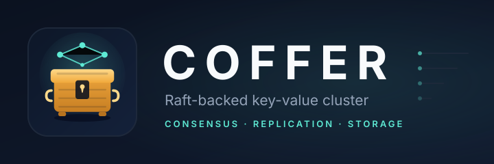

<p align="center">
  
</p>

<p align="center">
  <a href="https://github.com/BrunoMVPCosta/coffer/actions/workflows/ci.yml">
    
  </a>
  <a href="LICENSE">
    
  </a>
</p>

Coffer is a small distributed key-value store built in Java 21 on a custom
Netty transport, gossip membership, and Raft consensus. Writes are replicated
through a Raft log; reads are served by the node you contact.

<p align="center">
  <a href="https://www.thrownewexception.com/">Blog</a> ·
  <a href="https://github.com/BrunoMVPCosta/coffer">Source</a>
</p>

## Discovery

Nodes start with a list of seed addresses and discover the rest of the cluster at runtime:

- a joining node sends `JOIN` to each seed until one answers with `WELCOME` containing the member list
- the node handling the join broadcasts `MEMBERS` to the peers it already knows
- every node pings its peers every 2 seconds and removes a peer after 3 missed heartbeats
- a node that shuts down cleanly broadcasts `LEAVE`

Each node advertises itself as `host:port`, where the host comes from the `NODE_HOST` environment variable (or the local address when unset) and the cluster name from `CLUSTER_NAME` (default `coffer-cluster`).

## Membership

Every node advertises the same identity plus two pieces of membership metadata:

- an **incarnation** number, owned by the node itself and initialised from the
  wall clock so a restarted process outranks the tombstone of its previous run
- a **state**: `ALIVE`, `SUSPECT` or `DEAD`

Membership updates are merged with last-writer-wins semantics: a higher
incarnation always wins; at the same incarnation a higher state wins (`DEAD`
over `SUSPECT` over `ALIVE`). This makes concurrent updates converge
deterministically and stops a delayed message from resurrecting a dead node.

A dead node is kept as a **tombstone** for five minutes. If a node hears that it
is dead or suspected, it increments its own incarnation and gossips `ALIVE`
again. Nodes exchange their full membership view with every heartbeat
(anti-entropy), so a lost update is repaired on the next round.

## Connections

The transport keeps one pooled connection per peer address. A connection is
reused while it is active; after a close or a failed write the next message
reopens it. Concurrent callers racing to the same address share a single
in-flight connect attempt, and requests fail fast when the connect fails instead
of waiting for the request timeout.

## Raft

`RaftService` runs leader election, heartbeats and log replication over the
same transport:

- roles are `FOLLOWER`, `CANDIDATE` and `LEADER`; elections use randomized
  timeouts and a term-based `RequestVote` RPC
- the leader sends `AppendEntries` heartbeats every 300ms and also uses them to
  replicate log entries
- on election the leader appends a no-op entry in its new term, which lets it
  commit entries left over from previous terms
- followers truncate conflicting entries, append new ones and advance their
  commit index from `leaderCommit`
- a committed entry is handed to the registered applier in log order, which is
  the hook for a state machine such as a key-value store
- the Raft configuration is the **seed roster**, fixed for the lifetime of the
  process: every node must be given the same peers, and quorum is computed from
  that roster only. Discovery still maintains the address book and liveness
  hints, but later membership changes never shrink the majority needed to
  commit. Adding or removing a node requires restarting the cluster with the
  new roster (until Raft configuration changes are implemented)

### Persistence

The term, vote and compacted log are written to disk through `RaftStorage`.
`FileRaftStorage` keeps them in `raft-state.bin` and replaces the file
atomically (write to a temporary file, force it, then rename).

The state machine is snapshotted every `RAFT_SNAPSHOT_THRESHOLD` applied entries
(default 1024; `0` disables snapshots). A snapshot records the last included
index and term plus the serialized state in `raft-snapshot.bin`, and the log is
truncated before the snapshot index once the snapshot is durable. Serialization
happens under the Raft lock, but the write and fsync run on a dedicated
`raft-snapshot` thread, so the apply loop does not block on disk. A restart
restores the snapshot and replays only the entries after it, so the log stays
bounded instead of growing forever. A lagging follower catches up through
`InstallSnapshot`.

The data directory comes from `RAFT_DATA_DIR` (default `data/`) and gets one
subdirectory per node id. Docker Compose mounts a named volume per node at
`/data`, so a `docker compose down` followed by `up` keeps the Raft state.
Deleting a node's directory resets it.

Elections are delayed by a short discovery grace period so a node has a chance
to learn its peers before campaigning.

## Key-value store

`KvService` applies `Put` and `Delete` commands to an in-memory map in Raft log
order. Commands travel as `KV` envelopes, and the state machine is rebuilt by
replaying the persisted log after a restart.

- writes must reach the leader; a follower forwards the command and returns the
  leader's response
- reads are served by the contacted node, so a follower read can be stale
- a write is acknowledged only after the leader applies the committed entry

The CLI works in two modes. With only an address it opens a shell and keeps one
connection for the whole session:

```
docker compose exec node1 java -cp "coffer.jar:lib/*" io.github.brunomvpcosta.coffer.KvClient node2:8081
```

```
Connected to node2:8081
Type 'help' for commands, 'quit' to exit.
node2:8081> put foo bar
OK
node2:8081> get foo
bar
node2:8081> keys
foo
node2:8081> leader
node1:8080
node2:8081> info
role: FOLLOWER
term: 1
leader: node1:8080
keys: 1
node2:8081> del foo
OK
node2:8081> quit
```

The shell understands `put`, `get`, `del`, `keys`, `leader`, `info`, `help`
and `quit`. `keys` and `info` are answered by the contacted node, so they can
lag behind the leader.

For scripts, pass a command after the address:

```
docker compose exec node1 java -cp "coffer.jar:lib/*" io.github.brunomvpcosta.coffer.KvClient node2:8081 put foo bar
docker compose exec node1 java -cp "coffer.jar:lib/*" io.github.brunomvpcosta.coffer.KvClient node2:8081 get foo
docker compose exec node1 java -cp "coffer.jar:lib/*" io.github.brunomvpcosta.coffer.KvClient node2:8081 del foo
```

Locally, with the cluster running from Maven:

```
mvn -q compile exec:java -Dexec.mainClass=io.github.brunomvpcosta.coffer.KvClient -Dexec.args="127.0.0.1:8080"
```

Write to the leader, then read from each node to see replication. Read from a
follower only after it has caught up if you need read-after-write consistency.

## How to run with Docker

Builds the project and starts a 3-node cluster (no local Maven/Java needed):

```
docker compose up --build
```

Logs from all nodes are prefixed with the node name; `Ctrl+C` or `docker compose down` stops the cluster. Each node is also reachable from the host on `127.0.0.1:8080`, `127.0.0.1:8081` and `127.0.0.1:8082`.

## How to run locally

Requires JDK 21+ and Maven. Set `NODE_HOST=127.0.0.1` so each node's advertised
id matches the seed addresses; without it, followers cannot resolve the leader
for forwarded writes.

```
NODE_HOST=127.0.0.1 mvn -q compile exec:java -Dexec.mainClass=io.github.brunomvpcosta.coffer.ClusterNode -Dexec.args="8080 127.0.0.1:8081 127.0.0.1:8082"
```

```
NODE_HOST=127.0.0.1 mvn -q compile exec:java -Dexec.mainClass=io.github.brunomvpcosta.coffer.ClusterNode -Dexec.args="8081 127.0.0.1:8080 127.0.0.1:8082"
```

```
NODE_HOST=127.0.0.1 mvn -q compile exec:java -Dexec.mainClass=io.github.brunomvpcosta.coffer.ClusterNode -Dexec.args="8082 127.0.0.1:8080 127.0.0.1:8081"
```

## Future work

- Add integration tests to the transport layer
- Add linearizable reads (ReadIndex or leader lease)
- Implement Raft configuration changes instead of a static roster

## License

MIT. See [LICENSE](LICENSE).
